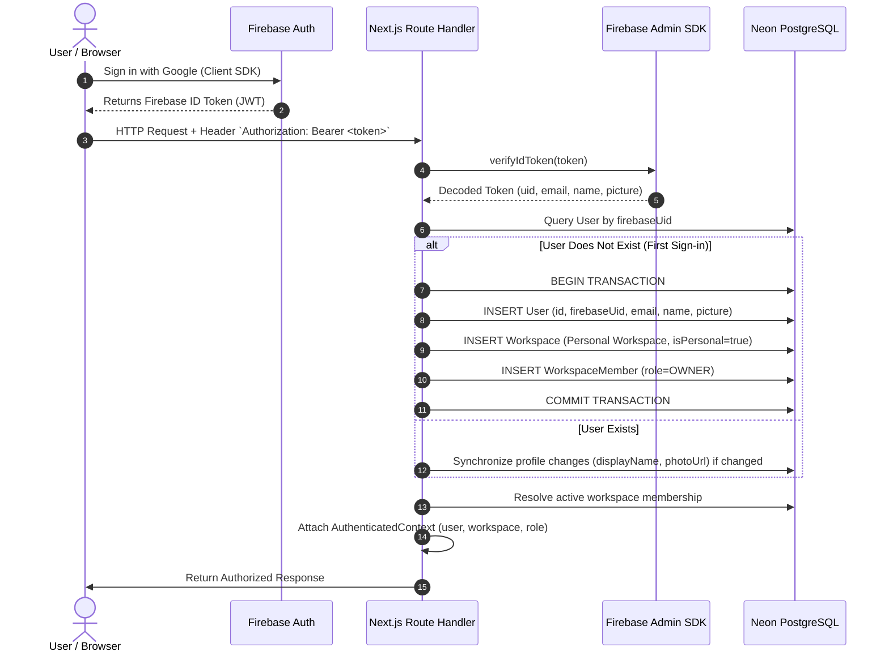

# TabSpace – Authentication & User Identity Specification

## 1. Authentication Architecture

TabSpace separates authentication from application data:
- **Identity Provider**: Firebase Authentication (Google Sign-In on the client).
- **Application Database**: PostgreSQL on Neon (Source of truth for all users, workspaces, and resources).
- **Session Mechanism**: Short-lived Firebase ID Tokens passed via the `Authorization: Bearer <idToken>` HTTP header, verified server-side using the `firebase-admin` SDK.

---

## 2. Server-Side Identity Verification Flow

---

## 3. Security Rules & Invariants

1. **Never Trust Client User IDs**: The client cannot specify `userId` in request bodies or query parameters. The authenticated user identity is derived exclusively from the verified Firebase ID token (`decodedToken.uid`).
2. **Never Trust Client Workspace IDs**: If a request supplies a `workspaceId`, the server validates that the authenticated user is an active member of that workspace in `WorkspaceMember`.
3. **Never Trust Client-Supplied Roles**: Role checks (`OWNER`, `ADMIN`, `MEMBER`) are queried from the database `WorkspaceMember` record; client-claimed roles are completely ignored.
4. **Extension Authentication**: Browser extensions authenticate using high-entropy API tokens (prefix `tab_live_...`). The server hashes incoming tokens with SHA-256 and matches against `ExtensionCredential.tokenHash`.

---

## 4. Firebase Admin Initialization

Firebase Admin SDK is initialized once at server startup as a singleton using server-only environment variables:
- `FIREBASE_PROJECT_ID`
- `FIREBASE_CLIENT_EMAIL`
- `FIREBASE_PRIVATE_KEY` (properly handling newlines in PEM keys: `key.replace(/\\n/g, '\n')`)
