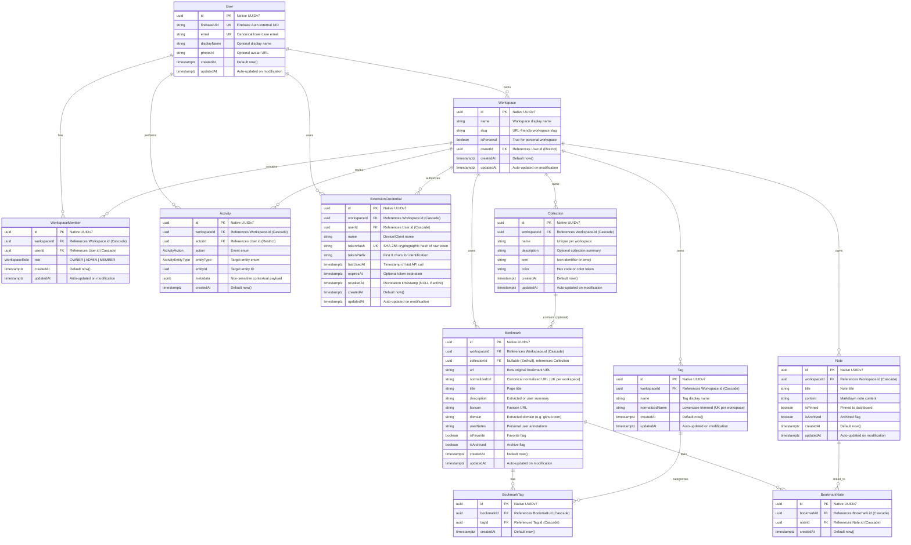

# TabSpace – Entity-Relationship (ER) Architecture

This document defines the relational database model for **TabSpace**, a personal digital workspace SaaS designed for personal workspaces today and collaborative team workspaces tomorrow.

---

## 1. Mermaid Entity-Relationship Diagram

---

## 2. Relational Cardinalities and Invariants

| Relationship | Cardinality | Deletion Behavior | Enforcement Mechanism |
|---|---|---|---|
| `User` $\rightarrow$ `Workspace` (Owner) | 1 : N | `Restrict` | A user cannot be deleted while owning active workspaces. |
| `Workspace` $\rightarrow$ `WorkspaceMember` | 1 : N | `Cascade` | Deleting a workspace removes all member associations. |
| `User` $\rightarrow$ `WorkspaceMember` | 1 : N | `Cascade` | Deleting a user removes their memberships. |
| `Workspace` $\rightarrow$ `Collection` | 1 : N | `Cascade` | Deleting a workspace cascades to collections. |
| `Workspace` $\rightarrow$ `Bookmark` | 1 : N | `Cascade` | Deleting a workspace cascades to bookmarks. |
| `Collection` $\rightarrow$ `Bookmark` | 1 : N (optional) | `SetNull` | Deleting a collection retains bookmarks (moves to uncategorized/inbox). |
| `Workspace` $\rightarrow$ `Tag` | 1 : N | `Cascade` | Deleting a workspace cascades to tags. |
| `Bookmark` $\leftrightarrow$ `Tag` (`BookmarkTag`) | M : N | `Cascade` | Deleting bookmark or tag removes junction records. |
| `Workspace` $\rightarrow$ `Note` | 1 : N | `Cascade` | Deleting a workspace cascades to notes. |
| `Bookmark` $\leftrightarrow$ `Note` (`BookmarkNote`) | M : N | `Cascade` | Deleting bookmark or note removes link records. |
| `Workspace` $\rightarrow$ `Activity` | 1 : N | `Cascade` | Workspace audit logs are removed on workspace deletion. |
| `User` (Actor) $\rightarrow$ `Activity` | 1 : N | `Restrict` | Prevents removing audit trail while actor records exist. |
| `Workspace` $\rightarrow$ `ExtensionCredential`| 1 : N | `Cascade` | Tokens revoked when workspace is removed. |
| `User` $\rightarrow$ `ExtensionCredential` | 1 : N | `Cascade` | Tokens revoked when user is removed. |

---

## 3. Database Constraints Summary

1. **`User`**:
   - `firebaseUid`: Globally UNIQUE.
   - `email`: Globally UNIQUE (enforced lowercase).
2. **`WorkspaceMember`**:
   - `(workspaceId, userId)`: UNIQUE (one membership per user per workspace).
3. **`Collection`**:
   - `(workspaceId, name)`: UNIQUE (no duplicate collection names in a workspace).
   - `(id, workspaceId)`: UNIQUE (used for composite foreign key validation).
4. **`Bookmark`**:
   - `(workspaceId, normalizedUrl)`: UNIQUE (no duplicate normalized URLs in the same workspace; identical URLs allowed across different workspaces).
   - `(collectionId, workspaceId)`: Composite FK referencing `Collection(id, workspaceId)` ensures bookmarks can never reference collections belonging to a different workspace.
5. **`Tag`**:
   - `(workspaceId, normalizedName)`: UNIQUE (prevents duplicate tags like "react" and "React" in the same workspace).
6. **`BookmarkTag`**:
   - `(bookmarkId, tagId)`: UNIQUE (cannot tag the same bookmark twice with the same tag).
7. **`BookmarkNote`**:
   - `(bookmarkId, noteId)`: UNIQUE (cannot link the same note twice to the same bookmark).
8. **`ExtensionCredential`**:
   - `tokenHash`: Globally UNIQUE (stored as SHA-256 hex digest, raw token never stored).
